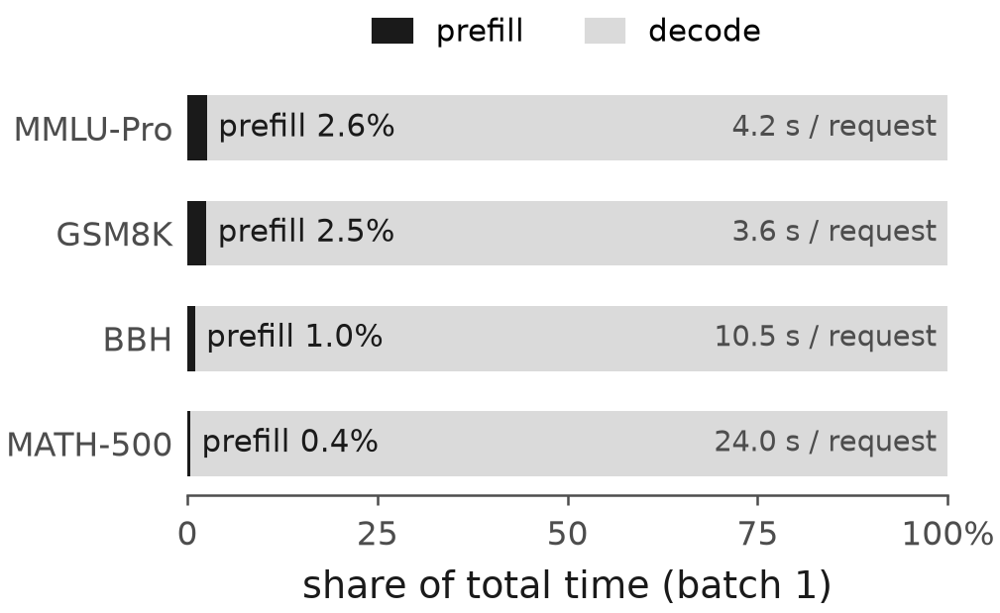

# Untying Prefill and Decode Loops in Looped Language Models

**Paper:** [`paper/untying-prefill-decode-loops.pdf`](paper/untying-prefill-decode-loops.pdf) (arXiv link coming) ·
**Author:** Yang Hu · **Code license:** MIT · **Keywords:** looped language model, recurrent depth, Ouro, test-time
compute, prefill vs decode, loop adapter, KV cache

Looped (recurrent-depth) language models run one block of layers several times per token, with the same number of
loops for reading the prompt (prefill) and for every answer token (decode). Generation is almost all decoding, so we
**untie the two loop counts**: read the prompt with *m* loops and decode each answer token with fewer, *n < m*. The
released model cannot do this by itself, so we distill a small adapter (at most 2.4% of the parameters): **LoRA on the
decoder** when the prefill depth is fixed ("Ours, fixed m"), or **LoopBridge** (LoRA plus per-loop key/value maps on
the prompt cache), which serves every trained (m, n) with one set of weights ("Ours, any m").

**Every number in the paper is recomputed from released per-item scores and timing records by one script** and checked
against the printed value: `python ouro/scripts/paper_numbers.py compute`. See [`REPRODUCE.md`](REPRODUCE.md).

The per-item scores make this a 1.1 GB checkout. To read the code alone:

```bash
git clone --filter=blob:none --no-checkout https://github.com/yanghu819/untying-prefill-decode
cd untying-prefill-decode && git sparse-checkout set --no-cone '/*' '!ouro/results' && git checkout paper-arxiv
```

The tag `paper-arxiv` is the commit the arXiv version was built from; the code is frozen there. The project finished
on 2026-11-19: [`ARCHIVE.md`](ARCHIVE.md) says where the training checkpoints, raw evaluation outputs and prepared
data went, and [`DEPRECATED.md`](DEPRECATED.md) which modules and training arms the paper does not use.

## Key findings (Ouro-2.6B unless stated)

1. **Generation is almost all decoding.** At batch 1, prefill is 0.3-2.6% of the time of a chain-of-thought answer.
2. **Same decode loops, more accuracy.** With one decode loop, four prefill loops raise the 11-benchmark average from
   44.2 (original model) to 58.6 (fixed-depth adapter) and 58.2 (LoopBridge), above the original model distilled to
   one loop on the same data (49.5; 49.3 at rank 80); with two decode loops, 63.7 -> 69.0 / 69.1. Both adapters beat
   the original 1/1 on all 11 benchmarks. MATH-500 is scored zero-shot (Minerva prompt without exemplars).
3. **A little more time, much more accuracy.** At one decode loop, our models take 14-21% more time per request than
   the original model and are +18.6 / +17.2 points more accurate (+12.2 / +10.8 over the distilled one; paired over 800
   timed requests, MATH-500 zero-shot). At the same mean time they beat a mix of the original model's 1/1 and 2/2
   settings by 10-14 points. With two decode loops they take 0.93-0.99x the time of Original 2/2 and Distilled 2/2 and
   score 3-7 points higher. Served at batch 32, LoopBridge 4/1 keeps +18.5 / +11.3 points for 1.18x / 1.19x their
   time.
4. **A few prefill loops suffice.** The gain peaks after two to five prefill loops (also for an adapter trained up to
   16 loops, over seeds, and when the prefill loops are trained too).
5. **It transfers** to Ouro-1.4B (both adapters 44.2-44.6 on average over three seeds, against 40.5 for the distilled
   model and 34.7 for the original), Ouro-2.6B-Thinking (LoopBridge 4/2 within 0.8 points of the original 4/4 on
   average, 1.1 +- 0.3 over three seeds, and 3.1 above Distilled 2/2; served in batches, as accurate as 4/4 on all 1,319 GSM8K problems, 94.6 vs
   94.2-94.3, in 0.47-0.57x its time) and
   looped decision models (Lev, +4.4 to +7.5 at one decision loop).
6. **LoopBridge's key/value maps keep retrieval over 16K-token prompts** when one adapter serves every depth
   (RULER-16K at 4/1 over three seeds: 63.9 vs 57.6 for a parameter-matched rank-80 LoRA and 44.7 at rank 16).
7. **The baselines are not under-tuned:** the distilled controls move by at most 0.8 points over a 0.3x-3x
   learning-rate range and at rank 80; LoopBridge's weakest learning rate still beats the best distilled control.





## When to use it, and when not

- Use more prefill loops when decoding must stay at one loop; with more time, a second decode loop buys more
  on long chain-of-thought answers.
- Two to five prefill loops are enough on most tasks; more can hurt. The best count depends on the task and the prompt
  format; it is chosen per setting, not per prompt.

## Repository map

| path | what |
|---|---|
| `REPRODUCE.md` | every table and figure → script → result file; training and evaluation commands |
| `ouro/scripts/paper_numbers.py`, `ouro/results/items/` | per-item scores of every run the paper uses; recomputes every number |
| `ouro/model.py`, `ouro/adapter_model.py`, `ouro/batched.py`, `ouro/train_batched.py` | frozen Ouro backbone, loop adapter, batched KL distillation from the native model |
| `ouro/single_bank.py`, `ouro/bench_throughput.py` | exact single-bank decoding (two flash-attention calls merged by log-sum-exp), native baselines, throughput |
| `ouro/evaluate_bench.py`, `ouro/lmeval_ouro.py`, `ouro/run_lmeval.py`, `ouro/lmeval_tasks/` | evaluation (RULER, HELMET; lm-evaluation-harness wrapper and zero-shot thinking tasks) |
| `ouro/sensenova_runner.py`, `ouro/sensenova_bridge.py` | SenseNova-Loop-9B (hybrid Gated-DeltaNet) runner, state splicing and loop adapter |
| `ouro/scripts/` | paper numbers, figures, end-to-end latency |
| `ouro/runs_scripts/` | the launchers used for every run |
| `third_party/ouro/` | Ouro modeling code (Apache-2.0, see its LICENSE) |
| `environments/ouro/` | the pinned environment every run used (`pyproject.toml`, `uv.lock`) |
| `paper/` | PDF, LaTeX source, figures, arXiv build script |
| `ARCHIVE.md`, `DEPRECATED.md` | where the heavy artifacts are kept; which code the paper does not use |
| `HANDOFF.md`, `NOTES.md` | the working log: what was run, what was dropped and why, in date order |

## Citation

```bibtex
@misc{hu2026untying,
  title  = {Untying Prefill and Decode Loops in Looped Language Models},
  author = {Hu, Yang},
  year   = {2026},
  note   = {https://github.com/yanghu819/untying-prefill-decode}
}
```
