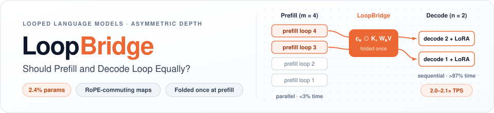
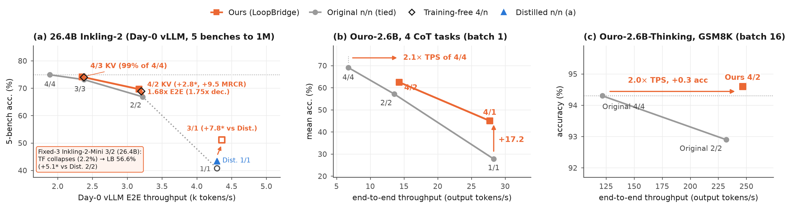
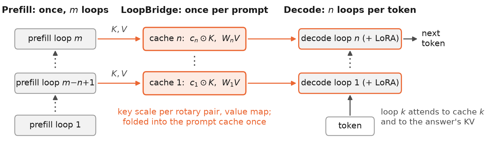
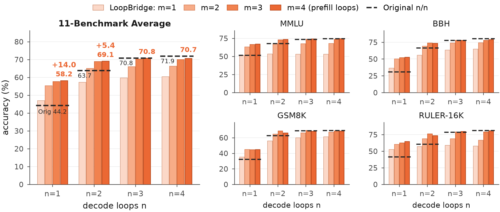
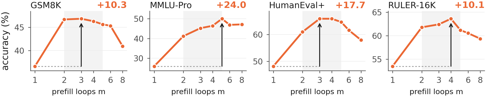
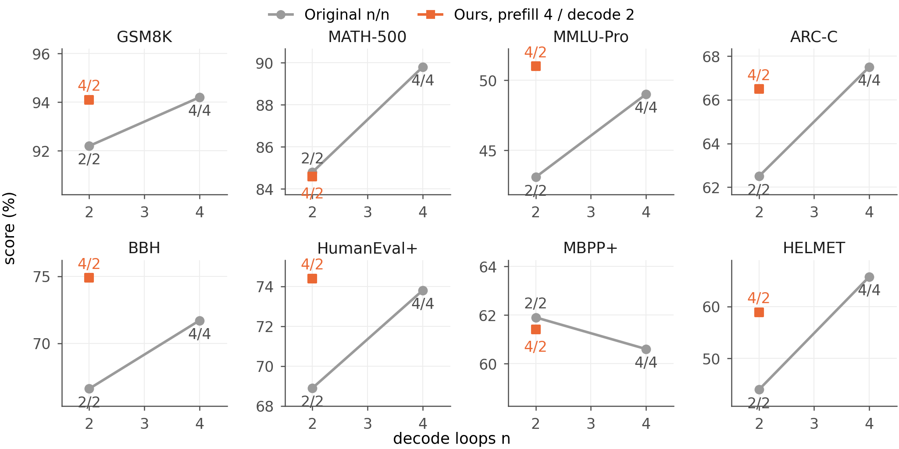
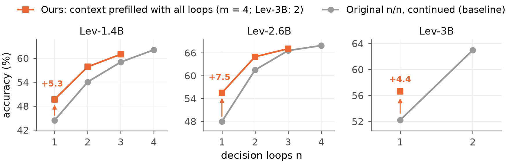

<div align="center">

<picture>
  <source media="(prefers-color-scheme: dark)" srcset="docs/assets/hero-dark.svg">
  <source media="(prefers-color-scheme: light)" srcset="docs/assets/hero-light.svg">
  
</picture>

<br/>

[](paper/loopbridge.pdf)
[](https://modelscope.cn/models/torushy/LoopBridge)
[](https://modelscope.cn/datasets/torushy/LoopBridge-Data)
[](REPRODUCE.md)
[](environments/ouro/pyproject.toml)
[](LICENSE)

[**Paper PDF**](paper/loopbridge.pdf) · [**Checkpoints (ModelScope)**](https://modelscope.cn/models/torushy/LoopBridge) · [**Data (ModelScope)**](https://modelscope.cn/datasets/torushy/LoopBridge-Data) · [**Results**](#results) · [**How It Works**](#how-loopbridge-works) · [**Quick Start**](#quick-start) · [**Reproduce**](REPRODUCE.md) · [**Citation**](#citation)

</div>

<br/>

Looped (recurrent-depth) language models reuse one block of layers for the same number of loops during prefill and decode. Yet generation is heavily asymmetric: at batch 1, prefill reads the prompt once in parallel (**<3%** of wall time), while decoding steps token by token (**>97%**).

**LoopBridge** unties prefill depth (*m*) from decode depth (*n* < *m*) with a lightweight **2.4%** adapter (decoder LoRA + RoPE-commuting key scales and linear value maps) distilled from Original 4/4. One adapter serves every trained (*m*, *n*) pair, preserves 16K-token retrieval, and **folds once into the prompt KV cache at prefill**—keeping Original *n*/*n*'s per-token decode speed intact.

<p align="center">
  <picture>
    <source media="(prefers-color-scheme: dark)" srcset="docs/assets/teaser_horizontal_dark.png">
    <source media="(prefers-color-scheme: light)" srcset="docs/assets/teaser_horizontal.png">
    
  </picture>
  <br/>
  <sub><b>Higher accuracy at higher throughput (tokens/s).</b> (a) Ouro-2.6B on 800 CoT requests (batch 1): LoopBridge 4/1 adds <b>+17.2</b> points at ~28 tok/s; 4/2 runs at <b>2.1×</b> Original 4/4's throughput. (b) Ouro-2.6B-Thinking on all 1,319 GSM8K problems (batch 16): LoopBridge 4/2 reaches <b>94.6%</b> at <b>2.0×</b> Original 4/4's throughput.</sub>
</p>

---

## Results

Every number below is recomputed directly from released per-item scores and timing logs via [`paper_numbers.py`](ouro/scripts/paper_numbers.py) (`0 printed values differ`).

### Ouro-2.6B (11-Benchmark Average & Batch-1 Serving)

| Method | Loops (*m*/*n*) | 11-Bench Avg | 3-Seed Mean | 800 CoT Acc | Throughput | Relative TPS |
| :--- | :---: | :---: | :---: | :---: | :---: | :---: |
| Original (Ouro) | 1/1 | 44.2 | — | 27.8% | 28.3 tok/s | 4.2× |
| Training-free | 4/1 | 28.7 | — | — | — | — |
| Distilled r16 / r80 (KD) | 1/1 | 49.5 / 49.3 | 49.6 / 49.2 | 34.2% | 26.6 tok/s | 4.0× |
| **LoopBridge (ours)** | **4/1** | **58.2** | **58.3 ± 0.1** | **45.0%** | **27.7 tok/s** | **4.1×** |
| Original (Ouro) | 2/2 | 63.7 | — | 57.1% | 13.6 tok/s | 2.0× |
| Distilled r16 / r80 (KD) | 2/2 | 66.2 / 65.5 | 66.1 / 65.6 | 59.2% | 13.6 tok/s | 2.0× |
| **LoopBridge (ours)** | **4/2** | **69.1** | **68.6 ± 0.4** | **62.5%** | **14.3 tok/s** | **2.1×** |
| Original (Ouro) | 4/4 | 71.9 | — | 69.1% | 6.7 tok/s | 1.0× |

<sub><i>11 benchmarks: MMLU, MMLU-Pro, BBH, ARC-C, HellaSwag, Winogrande, GSM8K, MATH-500 (zero-shot), HumanEval+, MBPP+, RULER-16K. 800 CoT: 200 timed requests each of GSM8K, MATH-500, BBH, MMLU-Pro on one B300 GPU. LoopBridge 4/1 also leads a time-matched Original 1/1–2/2 mix by <b>+10.5</b> points, and keeps <b>+18.5 / +11.3</b> points at batch 32 continuous batching in 1.18× / 1.19× time.</i></sub>

### Ouro-2.6B-Thinking (8-Benchmark Average & Batch-16 Serving)

| Method | Loops (*m*/*n*) | 8-Bench Avg | GSM8K (b16) | Wall Time / Req | Throughput (b16) | Speedup vs 4/4 |
| :--- | :---: | :---: | :---: | :---: | :---: | :---: |
| Original (Ouro-Thinking) | 2/2 | 65.5 | 92.9% | 4.04 s | 232 tok/s | 1.9× |
| Distilled r16 (KD) | 2/2 | 67.6 | 91.8% | 3.79 s | 236 tok/s | 1.9× |
| **LoopBridge (ours)** | **4/2** | **70.7** | **94.6%** | **3.19 s** | **247 tok/s** | **2.0×** |
| Original (Ouro-Thinking) | 4/4 | 71.5 | 94.3% | 6.84 s | 122 tok/s | 1.0× |

- **Transfers across scales & families:** Works on **Ouro-1.4B** (`34.7 → 44.5` at 4/1; `44.2 ± 0.2` over 3 seeds vs `40.5` distilled) and **Lev looped decision models** (`+4.4` to `+7.5` at one decision loop across all 13/13 *m* > *n* pairs).
- **Maps matter for long context:** Across 3 seeds on RULER-16K (4/1), LoopBridge scores **63.9 ± 1.0** vs **57.6 ± 1.6** for a parameter-matched rank-80 LoRA and **44.7 ± 4.4** for rank-16 LoRA.
- **Baselines are tuned:** Scaling the learning rate by `0.3×–3×` shifts Distilled baselines by at most **0.9** points; LoopBridge's weakest LR (`56.8`) stays far above the best distilled baseline (`49.5`).

---

## How LoopBridge Works

<p align="center">
  
</p>

1. **Aligned cross-loop mapping.** The frozen backbone prefills the prompt with *m* loops. Decode loop *k* ∈ {1, …, *n*} reads prefill loop `max(m - n + k, 1)` through a complex rotary key scale *c*<sub>*k*</sub> (which commutes with RoPE) and a linear value map *W*<sub>*k*</sub>, plus a shared rank-16 decoder-only LoRA (**63.3M** trainable params = **2.4%** of Ouro-2.6B).
2. **Folded once at prefill (zero decode overhead).** Because *c*<sub>*k*</sub> commutes with RoPE and attention is linear in *V*, both maps fold once into the prompt KV caches right after prefill—matching Original *n*/*n*'s KV footprint and running standard single-call FlashAttention during decoding. *(A lighter one-cache variant shares only the last prefill loop to cut prompt KV memory by n×.)*
3. **One adapter for all (*m*, *n*) pairs.** Distilled from Original 4/4 via forward KL over 48M answer tokens while sampling (*m*, *n*) per micro-batch; at tied *n*/*n*, serving can bypass the adapter for exact Original accuracy.

```python
# LoopBridge core (timed folded form; full exact per-step equivalence in ouro/single_bank.py)
def prefill_and_fold(prompt, m, n):
    h = embed(prompt[:-1])
    for j in range(m):                                 # frozen backbone, m parallel loops
        for l in range(L):
            h, K[j][l], V[j][l] = blocks[l](h)
    for k in range(n):                                 # fold RoPE-commuting key scale & value map once
        j = max(m - n + k, 0)
        for l in range(L):
            Kp[k][l] = complex_mul(K[j][l], c[k][l])   # c_k commutes with RoPE
            Vp[k][l] = V[j][l] @ W[k][l].T
    return Kp, Vp

def decode_step(token, Kp, Vp, kv_ans, n):
    h = embed(token)
    for k in range(n):                                 # n fast decode loops (+ shared decoder LoRA)
        for l in range(L):
            h = blocks_lora[l](h, prompt_kv=(Kp[k][l], Vp[k][l]), answer_kv=kv_ans[k][l])
    return lm_head(h)
```

---

## Key Insights

<p align="center">
  
  <br/>
  <sub><b>Directional asymmetry across all 16 (m, n) pairs.</b> Raising prefill loops from 1 to 4 lifts accuracy by 10–12 points at every decode depth, while running fewer prefill than decode loops (<i>m &lt; n</i>) consistently hurts.</sub>
</p>

<p align="center">
  
  <br/>
  <sub><b>A few prefill loops suffice.</b> Across tasks, seeds, and even trainable prefill, gains saturate within 2–5 prefill loops before drifting off-manifold.</sub>
</p>

<details>
<summary><b>More figures</b> (wall-time split, paired 1-loop comparison, Ouro-2.6B-Thinking 4/2, and Lev decision models)</summary>
<br/>
<table>
  <tr>
    <td align="center" width="50%">
      <br/>
      <sub><b>Prefill is &lt;3% of wall time</b> (batch 1 CoT)</sub>
    </td>
    <td align="center" width="50%">
      <br/>
      <sub><b>Paired 1-loop gain</b> (+17.2 / +10.8 on 800 requests)</sub>
    </td>
  </tr>
  <tr>
    <td align="center" width="50%">
      <br/>
      <sub><b>Ouro-2.6B-Thinking 4/2</b> across 8 benchmarks</sub>
    </td>
    <td align="center" width="50%">
      <br/>
      <sub><b>Lev decision models</b> (+4.4 to +7.5 at 1 decision loop)</sub>
    </td>
  </tr>
</table>
</details>

---

## Quick Start

### 1. Code-only clone (`< 5 MB`)

The full repository (~1.0 GB) bundles per-item scores and provenance logs so every paper number can be verified offline. If you only want the code and paper:

```bash
git clone --filter=blob:none --no-checkout https://github.com/yanghu819/loopbridge
cd loopbridge && git sparse-checkout set --no-cone '/*' '!ouro/results' && git checkout paper-arxiv
```

### 2. Verify every paper number & figure on a CPU (~30s, no GPU needed)

```bash
git clone https://github.com/yanghu819/loopbridge && cd loopbridge

# Recompute every table cell, paired bootstrap 95% CI, timing ratio & throughput from raw per-item scores
uv run --with numpy --with math-verify python ouro/scripts/paper_numbers.py compute
# Expected final line: wrote ouro/results/paper_numbers.json; 0 printed values differ (0 in the paired comparisons)

# Redraw all 14 paper figures & generated LaTeX tables
uv run --with numpy --with matplotlib python ouro/scripts/paper_figs.py
```

### 3. Download released checkpoints & distillation data (ModelScope)

All 8 core LoopBridge adapters (SHA256-verified against [`ouro/results/provenance/`](ouro/results/provenance)) and the GPQA-free 48M-token distillation mix + RULER/HELMET evaluation archives are publicly hosted on ModelScope:

- **Adapter Checkpoints:** [`torushy/LoopBridge`](https://modelscope.cn/models/torushy/LoopBridge) (`ouro-2.6b`, `ouro-2.6b-thinking`, `ouro-1.4b`, `ouro-1.4b-thinking`; both per-loop and one-cache variants)
- **Distillation & Eval Data:** [`torushy/LoopBridge-Data`](https://modelscope.cn/datasets/torushy/LoopBridge-Data) (`mix-data-48m.tar.gz`, `bench.tar.gz`, `bench-mini.tar.gz`)
- **Base Models (ModelScope / HF):** [Ouro-2.6B](https://modelscope.cn/models/bytedance-community/Ouro-2.6B) · [Ouro-2.6B-Thinking](https://modelscope.cn/models/bytedance-community/Ouro-2.6B-Thinking) · [Ouro-1.4B](https://modelscope.cn/models/bytedance-community/Ouro-1.4B) · [Ouro-1.4B-Thinking](https://modelscope.cn/models/bytedance-community/Ouro-1.4B-Thinking) · [Inkling-2-Mini](https://huggingface.co/thinkingmachines/Inkling-2-Mini)

```bash
pip install modelscope
modelscope download --model torushy/LoopBridge --local_dir ./checkpoints
modelscope download --dataset torushy/LoopBridge-Data --local_dir ./loopbridge-data
```

### 4. Train & evaluate on GPUs

```bash
cd environments/ouro && uv sync && cd ../..
```

See **[`REPRODUCE.md`](REPRODUCE.md)** for the full table/figure-to-script mapping, data preparation, training launchers, evaluation commands, and continuous-batching benchmarks.

---

## Repository Layout

```text
loopbridge/
├── ouro/
│   ├── adapter_model.py        # LoopBridge adapter (RoPE-commuting key scales, value maps, decoder LoRA)
│   ├── single_bank.py          # Folded-cache & exact LSE-merged single-bank inference runners
│   ├── batched.py              # Batched forward KL distillation (LoopBridge & Distilled n/n baselines)
│   ├── train_batched.py        # Multi-GPU DDP training entrypoint
│   ├── model.py                # Frozen Ouro looped backbone & cache wrappers
│   ├── evaluate_bench.py       # RULER & HELMET evaluation runner
│   ├── lmeval_ouro.py          # lm-evaluation-harness integration & zero-shot Thinking tasks
│   ├── lev/                    # Lev looped decision-model untied training & LevBench evaluation
│   ├── scripts/                # paper_numbers.py, paper_figs.py, batch_requests.py, time_requests.py, provenance.py
│   ├── runs_scripts/           # Exact training & evaluation launchers for every run in the paper
│   └── results/                # Per-item scores (items/), timing (e2e/, throughput-sb4/), lev/, provenance/
├── paper/
│   ├── loopbridge.pdf          # Compiled 26-page arXiv preprint
│   ├── latex/                  # Single-source ACL LaTeX & bibliography
│   ├── figs/                   # All 14 paper figures (PDF/PNG) & generated LaTeX table fragments
│   └── build_arxiv.py          # Reproducible arXiv tarball & PDF builder
├── environments/ouro/          # Pinned uv environment (pyproject.toml, uv.lock)
├── third_party/ouro/           # Ouro modeling code (Apache-2.0)
├── docs/                       # Cold-archive notes (ARCHIVE.md), legacy arms (DEPRECATED.md), README assets
└── REPRODUCE.md                # End-to-end reproduction guide
```

> The tag `paper-arxiv` points to the exact commit that built [`paper/loopbridge.pdf`](paper/loopbridge.pdf) and all figures/tables. Details on cold-archived checkpoints and remaining optional legacy branches are in [`docs/ARCHIVE.md`](docs/ARCHIVE.md) and [`docs/DEPRECATED.md`](docs/DEPRECATED.md).

---

## Citation

```bibtex
@misc{hu2026loopbridge,
  title  = {LoopBridge: Should Prefill and Decode Loop Equally?},
  author = {Hu, Yang},
  year   = {2026},
  url    = {https://github.com/yanghu819/loopbridge}
}
```

## License

Code is released under the [MIT License](LICENSE). Third-party modeling and benchmark code under `third_party/ouro/` and `ouro/licenses/` retain their respective upstream licenses (Apache-2.0 / MIT).
