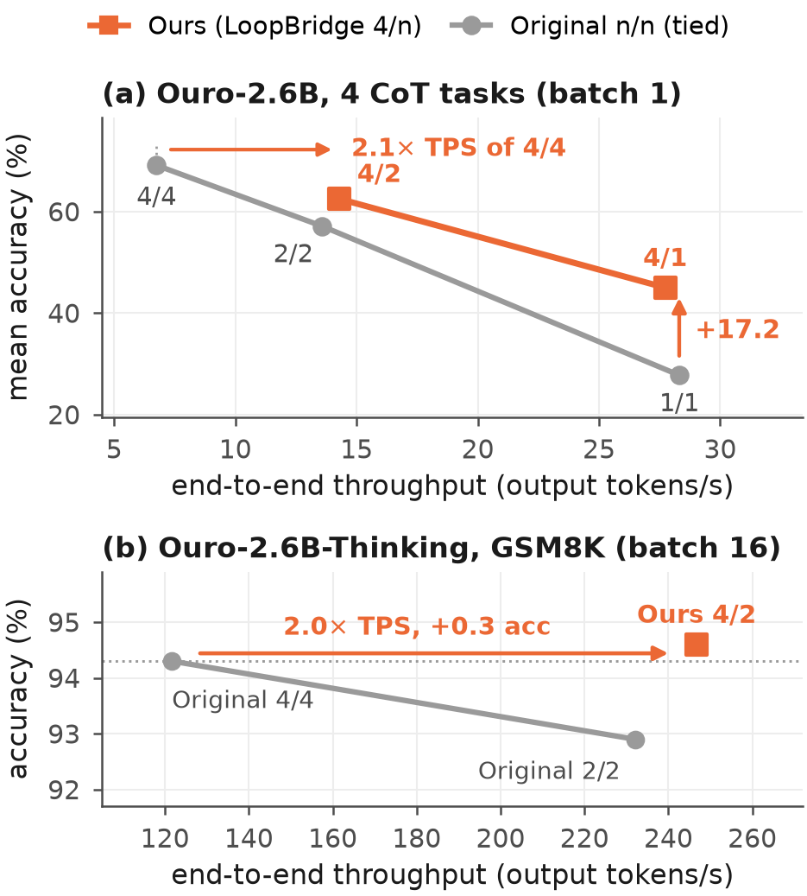
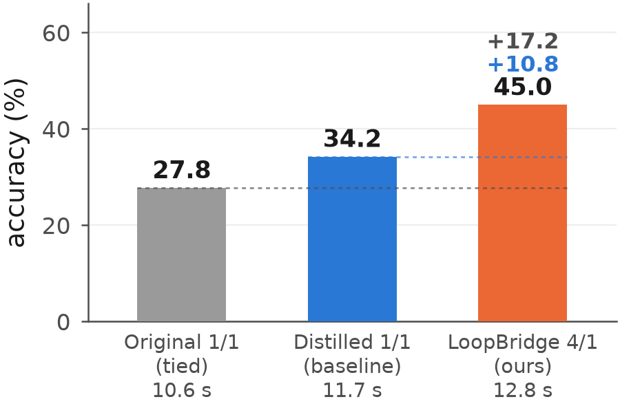

# LoopBridge: Should Prefill and Decode Loop Equally?

**Paper:** [`paper/untying-prefill-decode-loops.pdf`](paper/untying-prefill-decode-loops.pdf) (arXiv link coming) ·
**Author:** Yang Hu · **Code license:** MIT · **Keywords:** looped language model, recurrent depth, Ouro, test-time
compute, prefill vs decode, loop adapter, KV cache

Looped (recurrent-depth) language models apply the same block of layers for the same number of loops during prefill and
decode. Yet generation is heavily asymmetric: prefill reads the prompt once in parallel and takes under 3% of the wall
time, while decoding runs token by token and takes over 97%. We **untie the two loop counts**—reading the prompt with *m*
loops and decoding each answer token with fewer (*n < m*)—and introduce **LoopBridge**, a lightweight adapter (2.4% of
the parameters) combining decoder LoRA with RoPE-commuting key maps and linear value maps on the prompt cache. One set of LoopBridge
weights serves every trained *(m, n)* pair, preserves 16K-token retrieval, and folds into the prompt cache once at
prefill so decoding runs at virtually the original per-token speed. (A restricted fixed-*m*=4 decoder-only LoRA variant
is documented in Appendix L.)

**Every number in the paper is recomputed from released per-item scores and timing records by one script** and checked
against the printed value: `python ouro/scripts/paper_numbers.py compute`. See [`REPRODUCE.md`](REPRODUCE.md).

The per-item scores make this a 1.0 GB checkout. To read the code alone:

```bash
git clone --filter=blob:none --no-checkout https://github.com/yanghu819/untying-prefill-decode
cd untying-prefill-decode && git sparse-checkout set --no-cone '/*' '!ouro/results' && git checkout paper-arxiv
```

The tag `paper-arxiv` points to the exact commit the arXiv version and all figures/tables were built from. [`ARCHIVE.md`](ARCHIVE.md) says where the training checkpoints, raw evaluation outputs and prepared
data went, and [`DEPRECATED.md`](DEPRECATED.md) which modules and training arms the paper does not use.

## Key findings (Ouro-2.6B unless stated)

1. **Generation is almost all decoding.** At batch 1, prefill takes 0.3–2.6% of the wall time on chain-of-thought tasks
   (0.1–0.3% on Thinking models).
2. **Same decode loops, much higher accuracy.** At one decode loop, LoopBridge 4/1 lifts the 11-benchmark average from
   44.2 (Original 1/1) to **58.2** (three-seed mean 58.3 ± 0.1), nearly 9 points above tied-loop distillation on the
   same data (49.5; rank 80: 49.3); at two decode loops, 63.7 → **69.1** (vs. 66.2 for Distilled 2/2). LoopBridge 4/1
   beats Original 1/1 on all 11 benchmarks. MATH-500 is scored zero-shot (Minerva prompt without exemplars).
3. **Higher accuracy at higher throughput (tokens/s).** On 800 timed chain-of-thought requests at batch 1, LoopBridge
   4/1 reaches **45.0%** (+17.2 over Original 1/1, +10.8 over Distilled 1/1) at **27.7 tokens/s** (vs. 28.3 for
   Original 1/1) and stays **+10.5 points** above a time-matched Original 1/1–2/2 mix. At two decode loops, LoopBridge
   4/2 reaches **62.5%** at **14.3 tokens/s** (**2.1×** the 6.7 tokens/s of Original 4/4) in 0.94–0.99× the wall time of
   Original 2/2 and Distilled 2/2. At batch 32 continuous batching, LoopBridge 4/1 keeps +18.5 / +11.3 points over
   Original 1/1 and Distilled 1/1 in 1.18× / 1.19× their time.
4. **A few prefill loops suffice.** Gains peak within two to five prefill loops (also for an adapter trained up to 16
   loops, across seeds, and when the prefill loops themselves are trained).
5. **It transfers across scales and model families** to Ouro-1.4B (44.5 at 4/1, 44.2 ± 0.2 over three seeds, vs. 40.5
   distilled and 34.7 original), Ouro-2.6B-Thinking (LoopBridge 4/2 within 0.8 points of Original 4/4 on average across
   8 benchmarks, 1.1 ± 0.3 over three seeds, and +3.1 above Distilled 2/2; in batched serving, matches Original 4/4 on
   all 1,319 GSM8K problems—94.6% vs. 94.2–94.3%—at **2.0× end-to-end throughput** and 0.47–0.57× wall time), and
   looped decision models (Lev, +4.4 to +7.5 at one decision loop).
6. **LoopBridge's key and value maps preserve 16K-token retrieval** when one adapter serves every *(m, n)* pair
   (RULER-16K at 4/1 over three seeds: **63.9 ± 1.0** vs. 57.6 ± 1.6 for a parameter-matched rank-80 LoRA and
   44.7 ± 4.4 at rank 16).
7. **The baselines are not under-tuned:** the distilled controls move by at most 0.9 points over a 0.3×–3×
   learning-rate range (0.7 at rank 16, 0.9 at rank 80); LoopBridge's weakest learning rate (56.8) still stays well ahead of the best
   distilled baseline (49.5).






## When to use it, and when not

- Use more prefill loops when decoding must stay at one loop; with more time, a second decode loop buys more
  on long chain-of-thought answers.
- Two to five prefill loops are enough on most tasks; more can hurt. The best count depends on the task and the prompt
  format; it is chosen per setting, not per prompt.

## Repository map

| path | what |
|---|---|
| `REPRODUCE.md` | every table and figure → script → result file; training and evaluation commands |
| `ouro/scripts/paper_numbers.py`, `ouro/results/items/` | per-item scores of every run the paper uses; recomputes every number |
| `ouro/model.py`, `ouro/adapter_model.py`, `ouro/batched.py`, `ouro/train_batched.py` | frozen Ouro backbone, loop adapter, batched KL distillation from the native model |
| `ouro/single_bank.py`, `ouro/bench_throughput.py` | exact single-bank decoding (two flash-attention calls merged by log-sum-exp), native baselines, throughput |
| `ouro/evaluate_bench.py`, `ouro/lmeval_ouro.py`, `ouro/run_lmeval.py`, `ouro/lmeval_tasks/` | evaluation (RULER, HELMET; lm-evaluation-harness wrapper and zero-shot thinking tasks) |
| `ouro/lev/` | Lev looped decision-model scripts (`lev_rdws_eval.py`, `levbench_compare.py`, training/eval wrappers) |
| `ouro/scripts/` | paper numbers, figures, batched serving, end-to-end latency, provenance |
| `ouro/runs_scripts/` | the launchers used for every run |
| `third_party/ouro/` | Ouro modeling code (Apache-2.0, see its LICENSE) |
| `environments/ouro/` | the pinned environment every run used (`pyproject.toml`, `uv.lock`) |
| `paper/` | PDF, LaTeX source, figures, arXiv build script |
| `ARCHIVE.md`, `DEPRECATED.md` | where the heavy artifacts are kept; legacy training arms not used by the paper |

## Citation

```bibtex
@misc{hu2026untying,
  title  = {LoopBridge: Should Prefill and Decode Loop Equally?},
  author = {Hu, Yang},
  year   = {2026},
  note   = {https://github.com/yanghu819/untying-prefill-decode}
}
```
