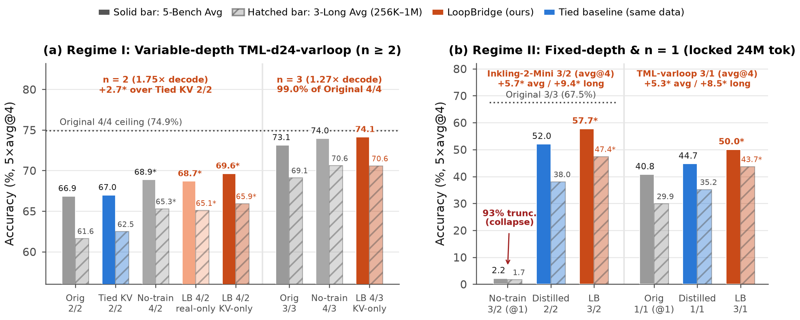
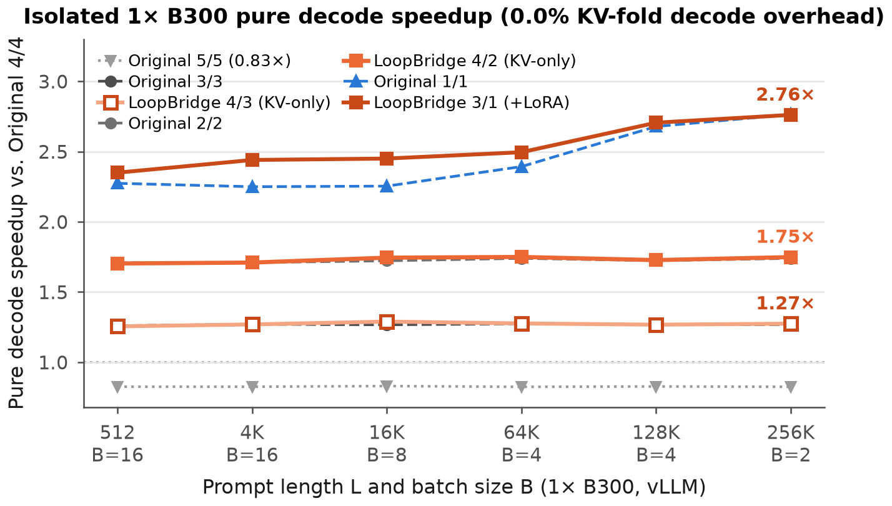
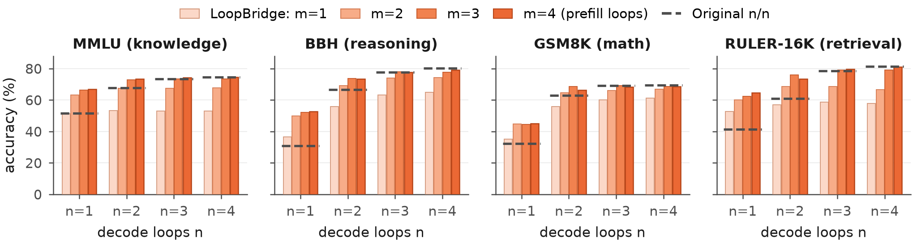
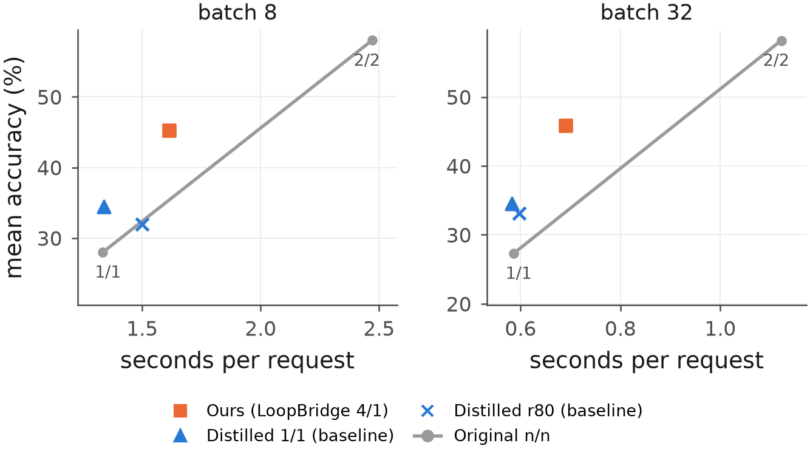

<div align="center">

<picture>
  <source media="(prefers-color-scheme: dark)" srcset="docs/assets/hero-dark.svg">
  <source media="(prefers-color-scheme: light)" srcset="docs/assets/hero-light.svg">
  
</picture>

<br/>

[](paper/loopbridge.pdf)
[](https://modelscope.cn/models/torushy/LoopBridge)
[](https://modelscope.cn/datasets/torushy/LoopBridge-Data)
[](REPRODUCE.md)
[](environments/ouro/pyproject.toml)
[](LICENSE)

[**Paper PDF**](paper/loopbridge.pdf) · [**Checkpoints (ModelScope)**](https://modelscope.cn/models/torushy/LoopBridge) · [**Data (ModelScope)**](https://modelscope.cn/datasets/torushy/LoopBridge-Data) · [**Results**](#results) · [**How It Works**](#how-loopbridge-works) · [**Quick Start**](#quick-start) · [**Reproduce**](REPRODUCE.md) · [**Citation**](#citation)

</div>

<br/>

Looped (recurrent-depth) language models reuse one block of layers for the same number of loops during prefill and decode. Yet generation is heavily asymmetric: at batch 1, prefill reads the prompt once in parallel (**<3%** of wall time), while decoding steps token by token (**>97%**).

**LoopBridge** unties prefill depth (*m*) from decode depth (*n* < *m*) with a lightweight adapter (**2.4%** on Ouro-2.6B; **0.017–0.25%** on 26.4B sparse-MoE looped models) that combines cache-foldable prompt KV maps (and optional decoder LoRA). It serves every trained (*m*, *n*) pair, preserves long-context retrieval up to 256K–1M tokens, and **folds once into the prompt KV cache at prefill**—keeping Original *n*/*n*'s per-token decode speed intact in both custom PyTorch runners and Thinking Machines' Day-0 vLLM Blackwell engine.

<p align="center">
  <picture>
    <source media="(prefers-color-scheme: dark)" srcset="docs/assets/teaser_horizontal_dark.png">
    <source media="(prefers-color-scheme: light)" srcset="docs/assets/teaser_horizontal.png">
    
  </picture>
  <br/>
  <sub><b>More prefill loops (<i>m</i>) and fewer decode loops (<i>n</i>) lift accuracy at high throughput across 2.6B dense and 26.4B sparse-MoE models (one B300).</b> (a) <b>Ouro-2.6B 11-Benchmark Average</b> across all 16 (<i>m</i>, <i>n</i>) pairs with measured overall end-to-end throughput (tok/s, batch 1, 4 CoT tasks; <code>n=3</code>: 400 reqs, others: 800; LoopBridge 4/1 = 27.7, 4/2 = 14.3): raising <i>m</i> to 4 adds <b>+14.0</b> at <code>n=1</code> (<b>4.2×</b> speed) and <b>+5.4</b> at <code>n=2</code> (<b>2.0×</b>), while <i>m</i> &lt; <i>n</i> hurts. (b) <b>10× scale-up to 26.4B Inkling-2</b> (<code>TML-d24-varloop</code> in Day-0 vLLM, 5 reasoning &amp; 256K–1M benchmarks; all trained and <code>n≥2</code> points at 5×avg@4, Orig 1/1 at @1): 4/3 recovers <b>99.0% of 4/4</b>, 4/2 beats 2/2 by <b>+2.8*</b> at <b>1.7×</b> E2E speed (no-train TF: 74.0/68.9), and 3/1 beats Distilled 1/1 by <b>+5.3*</b> (<code>p&lt;1e-4</code>).</sub>
</p>

---

## Results

Every number below is recomputed directly from released per-item scores and timing logs via [`inkling/make_figs.py`](inkling/make_figs.py) (26.4B sparse-MoE) and [`ouro/scripts/paper_numbers.py`](ouro/scripts/paper_numbers.py) (Ouro; `0 printed values differ`).

### 26.4B Sparse-MoE Looped Models in Day-0 vLLM (`TML-d24-varloop` & `Inkling-2-Mini`)

Evaluated in Thinking Machines' Day-0 vLLM Blackwell engine on five exact official splits (`GPQA Diamond` 198, `LiveCodeBench v6` 175, `MRCR v2 8n 256K–512K` 100, `GraphWalks BFS 256K` 100, `LongBench v2 1M` 503; **90,384 four-sample rollouts across 21 archived `5×avg@4` arms**), revealing a sharp **two-regime law** verified by a **14-arm (`60,256` rollouts) `2×2` causal double dissociation & 3-way Plato's Key ablation**, full **`5×avg@4` Regime II sweeps across BOTH backbones** (`Inkling-2-Mini 3/2`: `+5.70 [+4.10, +7.34]` 5-Bench, `+9.36 [+6.95, +11.84]` 3-Long; `TML-varloop 3/1`: `+5.31 [+3.53, +7.14]` 5-Bench, `+8.50 [+5.83, +11.23]` 3-Long, both `p<1e-4`), and Day-0 vLLM systems verification (`9/9` step-0 / `96.8–97.9%` 31-step PyTorch–vLLM parity, `1.29–2.80×` async Poisson ITL speedup, `0` preemptions under tested load matching equal-`m` KV occupancy):

<p align="center">
  
  <br/>
  <sub><b>Two-regime law and 2×2 causal proof on Thinking Machines' two 26.4B sparse-MoE looped models (vLLM, 5 benchmarks to 1M).</b> (a) <b>Regime I</b> (variable-depth <code>TML-d24-varloop</code>, <code>n ≥ 2</code>, 60,256 rollouts across 14 full 5×avg@4 arms): matched-data <code>Tied KV 2/2</code> (100% synth, <code>m=2</code>) stays flat at <b>67.0%</b> (<code>+0.1</code>), whereas untying <code>m=4</code> lifts real-only <code>LB 4/2</code> to <b>68.7%*</b> (matching no-training 4/2 at <b>68.9%*</b>) and full <code>LB 4/2 KV-only</code> (<code>r=0</code>, 17 MiB) to <b>69.6%*</b> (<code>+2.7* [p&lt;1e-3]</code> over Tied KV 2/2; <b>+2.8*</b> Holm-98.33% over Orig 2/2, <b>+9.5*</b> MRCR 512K); <code>LB 4/3 KV-only</code> recovers <b>99.0%</b> of Orig 4/4. (b) <b>Regime II</b> (full 5×avg@4 across all trained locked 24M-token controls; only unadapted baselines @1): fixed-3 <code>Inkling-2-Mini</code> no-training 3/2 collapses (2.2%, 93% trunc.), while parametric LoopBridge beats Distilled by <b>+5.7* (+9.4* long)</b> on <code>Mini 3/2</code> and <b>+5.3* (+8.5* long)</b> on <code>VarLoop 3/1</code> (both <code>p&lt;1e-4</code>).</sub>
</p>

- **Regime I, 2×2 Causal Control & 3-Way Plato's Key Proof (`TML-d24-varloop`, `n ≥ 2`):** Training-free untying works natively, and ultra-compact **KV-Only maps** (`r=0`, `4.46M–6.55M` params = `17.0–25.0 MiB` = **`0.017–0.025%`** of 26.4B, zero decode weight drift) rank #1 at both `4/3` (`1.27×` decode vs. `4/4`) and `4/2` (`1.75×` decode vs. `4/4`). Holding corpus, `t=4` teacher, and `r=0` 100% identical, untying `m=2 → 4` alone yields **`+2.65 [+1.14, +4.16]` 5-Bench (`p < 1e-3`; `+5.49` MRCR, `+3.43` 3-Long)** over matched `KV-Only 2/2` (`2.36M` active params, `+0.1` 5B: `+4.0` MRCR offset by `-1.6` LCB & `-2.0` GW), and stripping **100% of synthetic templates** (`0% nosynth 4/2`, `68.7%`, matching zero-training `TF 4/2 Tail` `68.9%`) still beats full-synthetic `KV-Only 2/2` by **`+1.71 [+0.05, +3.35]` 5-Bench (`+2.60` 3-Long, `+2.39` 1M LBv2; `+3.99` on strictly 13-gram-clean LBv2 `N=307`)**, while synthetic recall/BFS lifts `m=4` (`69.6%`; `+3.34` on 13-gram-clean LBv2 `N=307` vs. `-0.13` on overlapped items) ahead of both. In a 0-gradient closed-form **Plato's Key** test (192 unlabeled prompts / 240K tokens), orthogonal 1→1 `Procrustes 4/2` (`121s`, `0.79M` non-identity active) reaches `68.4%` (`70.4%` LCB #1 at `n=2`, `41.9%` dark-memory CV; matching TF 4/2 Anchored `68.4%`) and beats the unconstrained `Cross-Ridge 4/2` diagnostic (`60.7%`, `-7.63*`) because `K_4[1]≡K_2[1]` causes unconstrained MSE to regress onto shallow `p=1`; yet behavioral KL `LB 4/2 KV-Only` significantly beats `Procrustes 4/2` on 3-Long (`+2.45*`) and MRCR 512K (`+6.06*`, `59.2%` dark-memory CV), confirming both unit-scale orthogonality and cross-pass fusion are essential.
- **Regime II — Fixed-depth `Inkling-2-Mini` (`3/2`) & un-gated `n=1` (`3/1`), BOTH full `5×avg@4`:** All unadapted `n=2` variants collapse (`2.2%`, `93.2%` trunc. for Anchored TF 3/2; `5.6%` GPQA for Tail TF 3/2 & native Orig 2/2; `11.1%` GPQA / `81.8%` trunc. even for closed-form `Procrustes 3/2`; `40.8%` on `VarLoop 3/1`), while parametric LoopBridge rescues accuracy and beats parameter-advantaged tied distillation under locked 24M controls on BOTH backbones (`+5.70 [+4.10, +7.34]` 5-Bench, `+9.36 [+6.95, +11.84]` 3-Long, `p<1e-4`, lower truncation on all 5 splits on `Inkling-2-Mini 3/2`; `+5.31 [+3.53, +7.14]` 5-Bench, `+8.50 [+5.83, +11.23]` 3-Long, `p<1e-4`, 5/5 split sweep & lower micro truncation `12.9%` vs `14.5%` on `VarLoop 3/1`, where the 3-step `5×avg@4` KV-map ladder climbs monotonically `48.9 → 49.7 → 50.0` 5-Bench and `26.7 → 29.6 → 31.4` 512K MRCR [`+4.70 [+0.84, +8.53]`, two-sided `p=0.017`; single-pass KV `+2.37*` 3-Long, `p=0.030`]; `3.55–4.5×` faster training).
- **All verified 26.4B & Ouro checkpoints** are released on [ModelScope](https://modelscope.cn/models/torushy/LoopBridge).

<details>
<summary><b>Full per-benchmark 26.4B numbers (21 full 5×avg@4 arms = 90,384 rollouts + @1 diagnostics) & isolated 512–256K decode speedup figure</b></summary>
<br/>

| Backbone (26.4B MoE) | Method | Params | GPQA | LCB v6 | MRCR 512K | GW 256K | LBv2 1M | 3-Long | 5-Bench | vLLM Decode (`256K B=2`) |
| :--- | :--- | ---: | ---: | ---: | ---: | ---: | ---: | ---: | ---: | ---: |
| `TML-d24-varloop` (`@4`) | Original 4/4 (ceiling) | 0 | 82.6 | 76.7 | 94.0 | 56.3 | 64.9 | 71.7 | 74.9 | 1.00× (232 tok/s) |
| `TML-d24-varloop` (`@4`) | Original 3/3 | 0 | 82.3 | 76.0 | 90.4 | 52.2 | 64.7 | 69.1 | 73.1 | 1.27× (294 tok/s) |
| `TML-d24-varloop` (`@4`) | TF 4/3 (Tail / Anchored) | 0 | 83.0 / 83.1 | 75.7 / 74.9 | 91.0 / 93.4 | 50.9 / 52.0 | 65.9 / **66.5** | 69.2 / **70.6** | 73.3 / 74.0 | 1.27× (295 tok/s) |
| `TML-d24-varloop` (`@4`) | **LoopBridge 4/3 KV-Only (`r=0`, 25 MiB)** | **6.55M** | 82.5 | **76.4** | 91.7 | **54.5** | 65.6 | 70.6 | **74.1** | **1.27× (296 tok/s)** |
| `TML-d24-varloop` (`@4`) | Original 2/2 | 0 | 81.1 | 68.3 | 72.6 | 50.6 | 61.7 | 61.6 | 66.9 | 1.74× (404 tok/s) |
| `TML-d24-varloop` (`@4`) | KV-Only 2/2 (`m=2`, matched `v5_t4`, 100% synth) | 2.36M‡ | 80.7 | 66.7 | 76.7 | 48.6 | 62.2 | 62.5 | 67.0 | 1.74× |
| `TML-d24-varloop` (`@4`) | Cross-Ridge 4/2 (124s, 0-grad MSE, `r=0`) | 4.46M | 60.6 | 53.9 | 79.0 | 48.1 | 62.2 | 63.1 | 60.7 | 1.75× |
| `TML-d24-varloop` (`@4`) | Procrustes 4/2 (121s, 0-grad 1→1 SVD, `r=0`) | 0.79M‡ | 80.9 | **70.4** | 76.1 | 51.2 | 63.1 | 63.5 | 68.4 | 1.75× |
| `TML-d24-varloop` (`@4`) | TF 4/2 (Anchored / Tail) | 0 | 81.2 / 80.6 | 69.1 / 67.9 | 77.7 / 78.9 | 51.8 / 52.1 | 62.4 / **64.9** | 64.0 / 65.3 | 68.4 / 68.9 | 1.74× (403 tok/s) |
| `TML-d24-varloop` (`@4`) | **LoopBridge 4/2 KV-Only (`0% nosynth`, `r=0`)** | **4.46M** | 79.4 | 68.7 | 80.0 | 50.7 | 64.6 | 65.1 | 68.7 | **1.75×** |
| `TML-d24-varloop` (`@4`) | **LoopBridge 4/2 KV-Only (`r=0`, 17 MiB)** | **4.46M** | 80.9 | 69.4 | **82.2†** | 51.9 | 63.7 | **65.9†** | **69.6†** | **1.75× (406 tok/s)** |
| `TML-d24-varloop` (`@1`) | Orig 1/1 / TF 3/1 | 0 | 74.7 / 72.7 | 39.4 / 40.6 | 20.7 / 19.5 | 20.0 / 14.4 | 48.9 / 56.7 | 29.9 / 30.2 | 40.8 / 40.8 | 2.76× (642 tok/s) |
| `TML-d24-varloop` (`@4`) | Distilled 1/1 (24M ctrl) | 43.7M | 73.1 | 45.0 | 24.3 | 28.0 | 53.2 | 35.2 | 44.7 | 2.76× |
| `TML-d24-varloop` (`@4`) | LB 3/1, no KV / 1-pass KV (24M ablations) | 32.8 / 33.6M | **74.1** / 71.7 | 44.4 / 43.7 | 26.7 / 29.6 | 39.1 / **42.9** | 60.2 / **60.6** | 42.0 / **44.4** | 48.9 / 49.7 | 2.76× |
| `TML-d24-varloop` (`@4`) | **LoopBridge 3/1 (24M ctrl, 3.55× faster train)** | **34.6M** | 73.7 | **45.4** | **31.4\*** | 39.0\* | **60.6\*** | 43.7\* | **50.0\*** | **2.76× (641 tok/s)** |
| `Inkling-2-Mini` (`@4`) | Original 3/3 (teacher, symmetric 57K cap) | 0 | 84.3 | 78.6 | 50.3 | 58.5 | 65.7 | 58.2 | 67.5 | 1.00× (295 tok/s) |
| `Inkling-2-Mini` (`@4`) | Distilled 2/2 (24M ctrl) | 47.4M | 81.1 | 65.0 | 17.1 | 39.6 | 57.4 | 38.0 | 52.0 | 1.36× (401 tok/s) |
| `Inkling-2-Mini` (`@4`) | **LoopBridge 3/2 (24M ctrl, 4.5× faster train)** | **39.9M** | 81.1 | **65.4** | **28.8\*** | **50.7\*** | **62.7\*** | **47.4\*** | **57.7\*** | **1.37× (403 tok/s)** |
| `Inkling-2-Mini` (`@1`) | TF 3/2 Anchored (93.2% trunc collapse) | 0 | 3.0 | 2.9 | 0.2 | 0.0 | 4.8 | 1.7 | 2.2 | 1.37× |
| `Inkling-2-Mini` (`@1`) | Orig 2/2 / TF 3/2 Tail / Procrustes 3/2 (GPQA) | 0 / 0.79M‡ | 5.6 / 5.6 / 11.1 | – | – | – | – | – | – | 1.37× |
| `Inkling-2-Mini` (`@1`) | **LoopBridge 3/2 v2 (48M hybrid, `r=128`)** | **65.8M** | **82.8** | **66.9** | **29.9** | 49.0 | **63.0** | **47.3** | **58.3** | **1.37× (403 tok/s)** |

<sub><i>(`@4`): 21 archived full 5×avg@4 arms = 90,384 rollouts (14 Regime I arms = 60,256; 3 Inkling-2-Mini arms = 12,912; 4 TML-varloop n=1 control/ablation arms = 17,216); TF 5/2 Anchored = 67.8%. ‡Non-identity active params out of 4.46M allocated in the 4-slot <code>ParameterDict</code> (2.36M for <code>KV-Only 2/2</code> where 2 slots are zero at <code>m=2</code>; 0.79M non-identity [1.31M 1→1 slots] for anchored <code>Procrustes</code> since pass 0→0 is exact identity). 2×2 causal control: <code>LB 4/2 KV</code> vs. matched <code>KV-Only 2/2</code> = <code>+2.65 [+1.14, +4.16]</code> 5-Bench (<code>p&lt;1e-3</code>), <code>+3.43 [+1.28, +5.60]</code> 3-Long, <code>+5.49 [+0.59, +10.72]</code> MRCR; <code>0% nosynth LB 4/2</code> vs. full-synthetic <code>KV-Only 2/2</code> = <code>+1.71 [+0.05, +3.35]</code> 5-Bench, <code>+2.60 [+0.27, +5.00]</code> 3-Long, <code>+2.39 [+0.80, +4.03]</code> LBv2. Plato's Key 3-way: <code>LB 4/2 KV</code> vs. <code>Procrustes 4/2</code> = <code>+2.45 [+0.26, +4.62]</code> 3-Long, <code>+6.06 [+0.96, +11.33]</code> MRCR; vs. <code>Cross-Ridge 4/2</code> = <code>+8.89 [+7.11, +10.67]</code> 5-Bench. †LoopBridge 4/2 KV-Only clears zero vs. Orig 2/2 under both 95% and strict k=3 Holm-Bonferroni 98.33% clustered CIs (<code>+2.78 [+0.82, +4.67]</code> 5-Bench, <code>+4.29 [+1.37, +7.18]</code> 3-Long, <code>+9.54 [+2.91, +16.49]</code> MRCR 512K) plus uncloned 1M LBv2 (<code>+1.99 [+0.25, +3.73]</code>; <code>+3.34 [+0.98, +5.78]</code> on strictly 13-gram-clean N=307 vs. <code>-0.13</code> on overlapped items). Controlled 24M sweeps at full 5×avg@4 (*95% CI, both <code>p&lt;1e-4</code>): <code>+5.70 [+4.10, +7.34]</code> 5-Bench / <code>+9.36 [+6.95, +11.84]</code> 3-Long on Mini 3/2; <code>+5.31 [+3.53, +7.14]</code> 5-Bench / <code>+8.50 [+5.83, +11.23]</code> 3-Long on VarLoop 3/1 (KV-map ladder: <code>48.9 → 49.7 → 50.0</code> 5-Bench; <code>26.7 → 29.6 → 31.4</code> MRCR, <code>+4.70 [+0.84, +8.53]</code>, two-sided <code>p=0.017</code>; 1-pass KV <code>+2.37 [+0.25, +4.48]</code> 3-Long, <code>p=0.030</code>).</i></sub>

<p align="center">
  
</p>
</details>

### Ouro-2.6B (11-Benchmark Average & Batch-1 Serving)

| Method | Loops (*m*/*n*) | 11-Bench Avg | 3-Seed Mean | 800 CoT Acc | Throughput | Relative TPS |
| :--- | :---: | :---: | :---: | :---: | :---: | :---: |
| Original (Ouro) | 1/1 | 44.2 | — | 27.8% | 28.3 tok/s | 4.2× |
| Training-free | 4/1 | 28.7 | — | — | — | — |
| Distilled r16 / r80 (KD) | 1/1 | 49.5 / 49.3 | 49.6 / 49.2 | 34.2% | 26.6 tok/s | 4.0× |
| **LoopBridge (ours)** | **4/1** | **58.2** | **58.3 ± 0.1** | **45.0%** | **27.7 tok/s** | **4.1×** |
| Original (Ouro) | 2/2 | 63.7 | — | 57.1% | 13.6 tok/s | 2.0× |
| Distilled r16 / r80 (KD) | 2/2 | 66.2 / 65.5 | 66.1 / 65.6 | 59.2% | 13.6 tok/s | 2.0× |
| **LoopBridge (ours)** | **4/2** | **69.1** | **68.6 ± 0.4** | **62.5%** | **14.3 tok/s** | **2.1×** |
| Original (Ouro) | 4/4 | 71.9 | — | 69.1% | 6.7 tok/s | 1.0× |

<sub><i>11 benchmarks: MMLU, MMLU-Pro, BBH, ARC-C, HellaSwag, Winogrande, GSM8K, MATH-500 (zero-shot), HumanEval+, MBPP+, RULER-16K. 800 CoT: 200 timed requests each of GSM8K, MATH-500, BBH, MMLU-Pro on one B300 GPU. LoopBridge 4/1 also leads a time-matched Original 1/1–2/2 mix by <b>+10.5</b> points, and keeps <b>+18.5 / +11.3</b> points at batch 32 continuous batching in 1.18× / 1.19× time.</i></sub>

### Ouro-2.6B-Thinking (8-Benchmark Average & Batch-16 Serving)

| Method | Loops (*m*/*n*) | 8-Bench Avg | GSM8K (b16) | Wall Time / Req | Throughput (b16) | Speedup vs 4/4 |
| :--- | :---: | :---: | :---: | :---: | :---: | :---: |
| Original (Ouro-Thinking) | 2/2 | 65.5 | 92.9% | 4.04 s | 232 tok/s | 1.9× |
| Distilled r16 (KD) | 2/2 | 67.6 | 91.8% | 3.79 s | 236 tok/s | 1.9× |
| **LoopBridge (ours)** | **4/2** | **70.7** | **94.6%** | **3.19 s** | **247 tok/s** | **2.0×** |
| Original (Ouro-Thinking) | 4/4 | 71.5 | 94.3% | 6.84 s | 122 tok/s | 1.0× |

- **Transfers across scales & families:** Works on **Ouro-1.4B** (`34.7 → 44.5` at 4/1; `44.2 ± 0.2` over 3 seeds vs `40.5` distilled) and **Lev looped decision models** (`+4.4` to `+7.5` at one decision loop across all 13/13 *m* > *n* pairs).
- **Maps matter for long context:** Across 3 seeds on RULER-16K (4/1), LoopBridge scores **63.9 ± 1.0** vs **57.6 ± 1.6** for a parameter-matched rank-80 LoRA and **44.7 ± 4.4** for rank-16 LoRA.
- **Baselines are tuned:** Scaling the learning rate by `0.3×–3×` shifts Distilled baselines by at most **0.9** points; LoopBridge's weakest LR (`56.8`) stays far above the best distilled baseline (`49.5`).

---

## How LoopBridge Works

<p align="center">
  
</p>

1. **Aligned cross-loop mapping.** The frozen backbone prefills the prompt with *m* loops. Decode loop *k* ∈ {1, …, *n*} reads prefill loop `max(m - n + k, 1)` through a complex rotary key scale *c*<sub>*k*</sub> (which commutes with RoPE) and a linear value map *W*<sub>*k*</sub>, plus a shared rank-16 decoder-only LoRA (**63.3M** trainable params = **2.4%** of Ouro-2.6B).
2. **Folded once at prefill (zero decode overhead).** Because *c*<sub>*k*</sub> commutes with RoPE and attention is linear in *V*, both maps fold once into the prompt KV caches right after prefill—matching Original *n*/*n*'s KV footprint and running standard single-call FlashAttention during decoding. *(A lighter one-cache variant shares only the last prefill loop to cut prompt KV memory by n×.)*
3. **One adapter for all (*m*, *n*) pairs.** Distilled from Original 4/4 via forward KL over 48M answer tokens while sampling (*m*, *n*) per micro-batch; at tied *n*/*n*, serving can bypass the adapter for exact Original accuracy.

```python
# LoopBridge core (timed folded form; full exact per-step equivalence in ouro/single_bank.py)
def prefill_and_fold(prompt, m, n):
    h = embed(prompt[:-1])
    for j in range(m):                                 # frozen backbone, m parallel loops
        for l in range(L):
            h, K[j][l], V[j][l] = blocks[l](h)
    for k in range(n):                                 # fold RoPE-commuting key scale & value map once
        j = max(m - n + k, 0)
        for l in range(L):
            Kp[k][l] = complex_mul(K[j][l], c[k][l])   # c_k commutes with RoPE
            Vp[k][l] = V[j][l] @ W[k][l].T
    return Kp, Vp

def decode_step(token, Kp, Vp, kv_ans, n):
    h = embed(token)
    for k in range(n):                                 # n fast decode loops (+ shared decoder LoRA)
        for l in range(L):
            h = blocks_lora[l](h, prompt_kv=(Kp[k][l], Vp[k][l]), answer_kv=kv_ans[k][l])
    return lm_head(h)
```

---

## Key Insights

<p align="center">
  
  <br/>
  <sub><b>Per-domain directional asymmetry across all 16 (m, n) pairs.</b> Knowledge (MMLU) and retrieval (RULER-16K) depend heavily on prefill depth <i>m</i>, while multi-step reasoning (BBH, GSM8K) also benefits strongly from decode depth <i>n</i>; running <i>m &lt; n</i> consistently hurts.</sub>
</p>

<p align="center">
  
  <br/>
  <sub><b>A few prefill loops suffice.</b> Across tasks, seeds, and even trainable prefill, gains saturate within 2–5 prefill loops (around pretrained depth <i>m</i> = 4) before drifting off-manifold.</sub>
</p>

<details>
<summary><b>More figures</b> (wall-time split, paired 1-loop comparison, batch 1/8/32 frontiers, Ouro-2.6B-Thinking 4/2, and Lev decision models)</summary>
<br/>
<table>
  <tr>
    <td align="center" width="50%">
      <br/>
      <sub><b>Prefill is &lt;3% of wall time</b> (batch 1 CoT)</sub>
    </td>
    <td align="center" width="50%">
      <br/>
      <sub><b>Paired 1-loop gain</b> (+17.2 / +10.8 on 800 requests)</sub>
    </td>
  </tr>
  <tr>
    <td align="center" width="50%">
      <br/>
      <sub><b>Ouro-2.6B-Thinking 4/2</b> across 8 benchmarks</sub>
    </td>
    <td align="center" width="50%">
      <br/>
      <sub><b>Lev decision models</b> (+4.4 to +7.5 at 1 decision loop)</sub>
    </td>
  </tr>
  <tr>
    <td align="center" colspan="2">
      <br/>
      <sub><b>Accuracy vs. wall time across batch 1, batch 8, and batch 32</b> (+10.5 / +9.8 / +12.4 over time-matched Original mix)</sub>
    </td>
  </tr>
</table>
</details>

---

## Quick Start

### 1. Code-only clone (`< 5 MB`)

The full repository (~1.0 GB) bundles per-item scores and provenance logs so every paper number can be verified offline. If you only want the code and paper:

```bash
git clone --filter=blob:none --no-checkout https://github.com/yanghu819/loopbridge
cd loopbridge && git sparse-checkout set --no-cone '/*' '!ouro/results' && git checkout main
```

### 2. Verify every paper number & figure on a CPU (~30s, no GPU needed)

```bash
git clone https://github.com/yanghu819/loopbridge && cd loopbridge

# Recompute every Ouro table cell, paired bootstrap 95% CI, timing ratio & throughput from raw per-item scores
uv run --with numpy --with math-verify python ouro/scripts/paper_numbers.py compute
# Expected final line: wrote ouro/results/paper_numbers.json; 0 printed values differ (0 in the paired comparisons)

# Redraw all 14 paper figures & verify 26.4B sparse-MoE paired bootstrap 95% CIs
uv run --with numpy --with matplotlib python ouro/scripts/paper_figs.py
uv run --with numpy --with matplotlib python inkling/make_figs.py
```

### 3. Download released checkpoints & distillation data (ModelScope)

All 16 core LoopBridge adapters (8 Ouro + 8 26.4B sparse-MoE, including the flagship `loopbridge-4x3-kvonly-12m` and `loopbridge-4x2-kvonly-12m` zero-LoRA checkpoints, every file SHA256-verified) and the GPQA-free 48M-token Ouro distillation mix + RULER/HELMET evaluation archives are publicly hosted on ModelScope:

- **Adapter Checkpoints:** [`torushy/LoopBridge`](https://modelscope.cn/models/torushy/LoopBridge) (`ouro-2.6b`, `ouro-2.6b-thinking`, `ouro-1.4b`, `ouro-1.4b-thinking`, `tml-d24-varloop`, `inkling-2-mini`)
- **Distillation & Eval Data:** [`torushy/LoopBridge-Data`](https://modelscope.cn/datasets/torushy/LoopBridge-Data) (`mix-data-48m.tar.gz`, `bench.tar.gz`, `bench-mini.tar.gz`)
- **Base Models (ModelScope / HF):** [Ouro-2.6B](https://modelscope.cn/models/bytedance-community/Ouro-2.6B) · [Ouro-2.6B-Thinking](https://modelscope.cn/models/bytedance-community/Ouro-2.6B-Thinking) · [Ouro-1.4B](https://modelscope.cn/models/bytedance-community/Ouro-1.4B) · [Ouro-1.4B-Thinking](https://modelscope.cn/models/bytedance-community/Ouro-1.4B-Thinking) · [TML-d24-varloop-research](https://huggingface.co/thinkingmachines/TML-d24-varloop-research) · [Inkling-2-Mini](https://huggingface.co/thinkingmachines/Inkling-2-Mini)

```bash
pip install modelscope
modelscope download --model torushy/LoopBridge --local_dir ./checkpoints
modelscope download --dataset torushy/LoopBridge-Data --local_dir ./loopbridge-data
```

### 4. Train & evaluate on GPUs

```bash
cd environments/ouro && uv sync && cd ../..
```

See **[`REPRODUCE.md`](REPRODUCE.md)** for the full table/figure-to-script mapping, data preparation, training launchers, Day-0 vLLM 26.4B MoE evaluation commands, and continuous-batching benchmarks.

---

## Repository Layout

```text
loopbridge/
├── ouro/
│   ├── adapter_model.py        # LoopBridge adapter (RoPE-commuting key scales, value maps, decoder LoRA)
│   ├── single_bank.py          # Folded-cache & exact LSE-merged single-bank inference runners
│   ├── batched.py              # Batched forward KL distillation (LoopBridge & Distilled n/n baselines)
│   ├── train_batched.py        # Multi-GPU DDP training entrypoint
│   ├── model.py                # Frozen Ouro looped backbone & cache wrappers
│   ├── evaluate_bench.py       # RULER & HELMET evaluation runner
│   ├── lmeval_ouro.py          # lm-evaluation-harness integration & zero-shot Thinking tasks
│   ├── lev/                    # Lev looped decision-model untied training & LevBench evaluation
│   ├── scripts/                # paper_numbers.py, paper_figs.py, batch_requests.py, time_requests.py, provenance.py
│   ├── runs_scripts/           # Exact training & evaluation launchers for every Ouro run in the paper
│   └── results/                # Per-item scores (items/), timing (e2e/, throughput-sb4/), lev/, provenance/
├── inkling/
│   ├── model.py                # 26.4B sparse-MoE NoPE global-3 KV maps + decode LoRA + AttnRes adapters
│   ├── vllm_loopbridge.py      # Zero-overhead Day-0 vLLM Blackwell integration (merged decode LoRA + prefill KV fold)
│   ├── train_inkling.py        # 8x B300 DDP length-bucketed KL / generalized JSD trainer
│   ├── prepare_data_v3.py      # Controlled 24M on-policy v3 distillation corpus builder (13-gram decontaminated)
│   ├── prepare_data_v4_gkd.py  # Hybrid verified SFT + on-policy OPD + 16K-52K v4 corpus builder
│   ├── prepare_official_exact.py # Official 256K-1M evaluation split builder (GPQA, LCB v6, MRCR, GraphWalks, LBv2)
│   ├── eval_vllm.py            # Multi-replica Day-0 vLLM official evaluator
│   ├── bench_vllm_timing.py    # Strictly isolated single-GPU SSE decode & E2E microbenchmark (512..256K)
│   ├── scoring.py              # Exact official benchmark scorers (+ test_scorers.py, test_model.py, test_vllm_parity.py)
│   ├── make_figs.py            # Recomputes 26.4B paired bootstrap CIs & draws Figures 15-16
│   └── results/                # Official-exact per-item eval JSONs & isolated Day-0 vLLM Blackwell timing logs
├── paper/
│   ├── loopbridge.pdf          # Compiled 32-page arXiv preprint (exact 8-page ACL main body + Appendices A-O)
│   ├── latex/                  # Single-source ACL LaTeX & bibliography
│   ├── figs/                   # All 16 paper figures (PDF/PNG) & generated LaTeX table fragments
│   └── build_arxiv.py          # Reproducible arXiv tarball & PDF builder
├── environments/ouro/          # Pinned uv environment (pyproject.toml, uv.lock)
├── third_party/ouro/           # Ouro modeling code (Apache-2.0)
├── docs/                       # Release archive notes (ARCHIVE.md), deprecated arms/scripts (DEPRECATED.md), README assets
└── REPRODUCE.md                # End-to-end reproduction guide
```

> The tag `paper-arxiv` points to the exact commit that built [`paper/loopbridge.pdf`](paper/loopbridge.pdf) and all figures/tables. Details on archived checkpoints and pruned legacy branches/scripts are in [`docs/ARCHIVE.md`](docs/ARCHIVE.md) and [`docs/DEPRECATED.md`](docs/DEPRECATED.md).

---

## Citation

```bibtex
@misc{hu2026loopbridge,
  title  = {LoopBridge: Should Prefill and Decode Loop Equally?},
  author = {Hu, Yang},
  year   = {2026},
  url    = {https://github.com/yanghu819/loopbridge}
}
```

## License

Code is released under the [MIT License](LICENSE). Third-party modeling and benchmark code under `third_party/ouro/` and `ouro/licenses/` retain their respective upstream licenses (Apache-2.0 / MIT).
